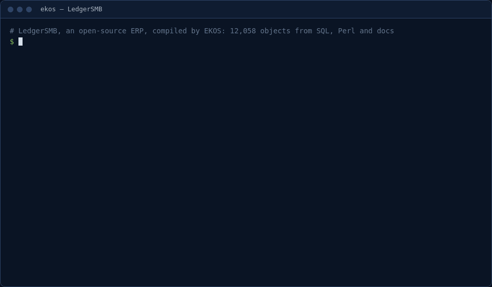
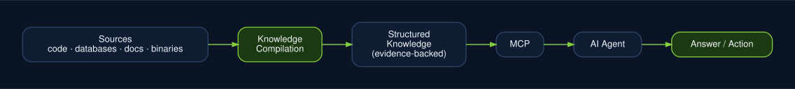

<h1 align="center">EKOS</h1>

<p align="center">
  <b>コード、データベース、ドキュメントを、AI エージェントが問い合わせられるナレッジグラフに。</b><br>
  すべての事実に、読み取り元のファイルと行番号が付きます。手元のマシンで動きます。オープンソース。
</p>

<p align="center">
  <a href="README.md">English</a> · <a href="README.zh-CN.md">简体中文</a> · <b>日本語</b>
</p>

<p align="center">
  <a href="https://github.com/alexeyban/EKOS/releases/latest"></a>
  <a href="LICENSE"></a>
  <a href="https://github.com/alexeyban/EKOS/actions/workflows/ci.yml"></a>
  <a href="https://sonarcloud.io/summary/new_code?id=alexeyban_EKOS"></a>
  <a href="https://github.com/alexeyban/EKOS/stargazers"></a>
</p>

<p align="center">
  <a href="#クイックスタート">クイックスタート</a> ·
  <a href="https://ekos.dev/ja/">ウェブサイト</a> ·
  <a href="https://ekos.dev/docs/">ドキュメント（英語）</a> ·
  <a href="https://ekos.dev/demo/">デモ動画</a> ·
  <a href="#計測結果">ベンチマーク</a> ·
  <a href="docs/REFERENCE.md">リファレンス（英語）</a> ·
  <a href="https://github.com/alexeyban/EKOS/discussions">ディスカッション</a>
</p>

<p align="center">
  <br>
  <sub>実際の出力です。EKOS がオープンソース ERP の LedgerSMB をコンパイルし、ソース間の食い違いを三件見つけました。各主張にファイルと行番号が付きます。</sub>
</p>

> この文書は [README.md](README.md) の日本語訳です。ドキュメント、リファレンス、デモ動画は現在英語のみです。

実際のシステムを扱う AI エージェントは、トークンの大半をシステムの調べ直しに使います。コードを grep し、スキーマを読み直し、各部分のつながりを推測する。これをセッションのたびに繰り返します。EKOS はその作業を一度だけ行います。ソースを読み取り、テーブル、関数、ジョブ、ドキュメントとそれらのつながりを一つのグラフにコンパイルし、[MCP](https://modelcontextprotocol.io/) 経由でエージェントに提供します。

- **推測ではなく、コンパイル。** グラフはパーサーと決定的なパスが構築します。コンパイルにモデル呼び出しは不要なので、同じソースからは常に同じ結果が得られます。
- **すべての事実に出典。** 回答は、元になったファイルと行番号、SQL 文、コミットを示します。二つのソースが食い違う場合、EKOS はどちらかを選ばず、その食い違いを報告します。
- **コードだけではありません。** アプリケーションコード、SQL スキーマとストアドプロシージャ、稼働中のデータベースカタログ、ETL ジョブ（dbt、Pentaho、Talend）、ドキュメント、Git 履歴を一つのグラフで扱います。
- **ローカルで、読み取り専用。** Rust 製の単一バイナリです。ソースは手元のマシンから出ず、エージェントには読み取り専用のアクセスだけが与えられ、シークレットは保存前にマスクされます。

## クイックスタート

**1. インストール**（Linux、macOS）：

```bash
curl -fsSL https://raw.githubusercontent.com/alexeyban/EKOS/main/install.sh | sh
```

Windows：

```powershell
powershell -ExecutionPolicy Bypass -c "irm https://raw.githubusercontent.com/alexeyban/EKOS/main/install.ps1 | iex"
```

ブラウザでセットアップページが開きます（ページは英語です）。プロジェクトのディレクトリを尋ね、EKOS を Claude Code、Claude Desktop、VS Code に登録します。ネイティブインストーラー（`.msi`、`.pkg`、`.deb`、`.rpm`）は[リリースページ](https://github.com/alexeyban/EKOS/releases)にあります。その他のインストール方法は[インストールガイド](https://ekos.dev/docs/getting-started/installation.html)を参照してください。

**2. リポジトリをコンパイル**（最初のプロジェクトはセットアップページが行います。ターミナルから同じことをする場合）：

```bash
cd /path/to/your/repo
ekos init --detect
ekos build && ekos recover && ekos resolve && ekos compile && ekos commit
```

**3. 質問する。** エージェントから、またはターミナルから：

```bash
ekos ask "what does this system do?"
ekos query find "payment" --mode hybrid
ekos ekl "FIND Object WHERE kind = 'Table'"
```

エージェントを手動で接続する場合：

```bash
claude mcp add ekos -- ekos mcp serve --workspace /path/to/your/repo
```

## 聞けること

| 質問 | 答えるもの |
|---|---|
| `orders` テーブルを変更すると何が壊れる？ | コード、SQL、ビュー、プロシージャ、ETL ジョブをまたぐ影響分析 |
| このテーブルはどこで、どのジョブによって書き込まれる？ | SQL、dbt、Pentaho、Talend を通したデータリネージ |
| このストアドプロシージャやレガシージョブは実際に何をしている？ | ステップごとの説明。各ステップに出典付き |
| 「前四半期の顧客別売上」の SQL を書いて | スキーマ、結合、コード値を把握し、回答前に自分のクエリをチェックする SQL エージェント |
| ドキュメントはまだコードやデータと一致している？ | 食い違いの一覧。それぞれの主張と、その記述場所付き |
| 先週から何が変わった？ | テキストファイルの差分ではなく、知識そのものの差分 |

## 仕組み

<p align="center">
  
</p>

1. **観測。** コネクタが各ソースをそのまま読み取ります。ファイル、Git 履歴、データベースカタログ、ドキュメント。取り込み時に要約や書き換えは行いません。
2. **コンパイル。** 決定的なパスがソースを解析し、二か所に現れる同じものを突き合わせ、オブジェクト、関係、イベントからなる一つのモデルを構築します。それぞれが自分の根拠を保持します。
3. **保存。** 結果は追記専用の台帳に書き込まれます。その場で書き換えることはないので、過去の任意の時点で何が分かっていたかを確認できます。
4. **提供。** エージェントは読み取り専用の MCP サーバーを通して台帳を読みます。人は CLI か Web コンソールを使います。

人だけが決めるべきことは、人が決めます。業務上の定義の確定、食い違いの裁定、移行の承認は、CLI またはコンソールでの操作です。エージェントが MCP 経由で行うことはできません。

## 計測結果

| テスト | 結果 |
|---|---|
| [BIRD Mini-Dev](https://alexeyban.github.io/EKOS/presentations/bird-mini-dev-benchmark.html) text-to-SQL、ホールドアウト 302 問、同一モデル（Claude Haiku 5.5） | 生のスキーマのみ **53.3%** → EKOS の知識とチェックあり **76.2%** |
| 2,022 ファイルのリポジトリ（[plausible/analytics](https://github.com/plausible/analytics)）での[トークン使用量](https://alexeyban.github.io/EKOS/presentations/token-benchmark.html)、grep ベースの検索との比較 | 1 問あたり**トークン 67〜93% 削減** |
| 同じリポジトリの初回コンパイル | **34 秒** |
| 903 テーブルの Oracle ERP（iDempiere）をエンドツーエンドで分析（[動画](https://youtu.be/pnGLymT6JH0)） | コンパイル時の**モデル呼び出し 0 回** |

各リンク先に、方法、コマンド、生の出力があります。EKOS が負けたケースも含みます。

## 読み取れるもの

| ソース | 対応範囲 |
|---|---|
| コード | Rust、Python（PySpark を含む）、JavaScript/TypeScript、Java、Elixir、Perl |
| SQL ファイル | PostgreSQL、Oracle、MySQL、SQL Server、Snowflake、Databricks、ClickHouse、Trino、SQLite。ビュー、トリガー、PL/pgSQL と PL/SQL のルーチン |
| 稼働中のデータベース | Oracle、PostgreSQL、ClickHouse のカタログ（読み取り専用） |
| ETL とモデリング | dbt、Pentaho Kettle、Talend |
| ドキュメント | Markdown、PDF、DOCX、HTML、スプレッドシート、スライド、Confluence |
| 履歴 | Git コミット、GitHub の issue と pull request |

## 比較

| | grep とファイル読み込み | ベクトル RAG | コードグラフツール | EKOS |
|---|---|---|---|---|
| 一度構築し、毎セッションで再利用 | いいえ | はい | はい | はい |
| 同じ入力から同じ結果 | はい | モデル次第 | ほぼ | はい |
| 各事実にファイルと行番号 | 手作業 | チャンク単位 | 一部 | はい |
| データベース、ETL ジョブ、ドキュメントを同じグラフで扱う | いいえ | テキストのみ | 主にコード | はい |
| ソース間の食い違いを報告 | いいえ | いいえ | いいえ | はい |

## エージェント以外の機能

- **Web コンソール**：プロジェクト、グラフビュー、レビューと承認、プロジェクトとのチャット、チームとロール。[デプロイガイド](docs/deployment.md)（英語）。
- **レビューワークフロー**：何かを構築する前に、人がソースモデルを承認します。[オペレーターのワークフロー](docs/operator-workflow.md)（英語）。
- **EKOS Lakehouse**：コンパイル済みの知識から、PostgreSQL または Oracle から Apache Iceberg へのパイプラインを生成し、Pentaho と Talend のジョブを dbt に変換します。[ekos-lakehouse](https://github.com/alexeyban/ekos-lakehouse)。
- **EKOS Migrate**：PostgreSQL から ClickHouse への移行。すべてのテーブルをソースと照合します。
- **エクスポート**：生成ドキュメント、dbt モデル、LinkML、Apache Ossie のセマンティックモデル。

すべての機能のコマンドごとの説明は、[リファレンス](docs/REFERENCE.md)と [ekos.dev/docs](https://ekos.dev/docs/) にあります（いずれも英語）。

## プロジェクト

EKOS は公開の場で開発されています。すべての機能は設計文書（[RFC](ekos/docs/rfcs/)）から始まり、[開発ログ](devlogs/)に、何をリリースし何を学んだかを記録しています。各リリースの内容は [CHANGELOG.md](CHANGELOG.md) にあります。

- 質問やアイデア：[GitHub Discussions](https://github.com/alexeyban/EKOS/discussions)
- バグ：[GitHub Issues](https://github.com/alexeyban/EKOS/issues)
- ニュース：X の [@ekosproject](https://x.com/ekosproject)
- チームとロードマップ：[ekos.dev/ja](https://ekos.dev/ja/)
- ソースからビルド：`cd ekos && cargo build --workspace`。crate の構成と開発フローは [CLAUDE.md](CLAUDE.md) を参照してください。

EKOS が役に立ったら、スターを付けていただけると、他の人が見つけやすくなります。

## ライセンス

MIT。[LICENSE](LICENSE) を参照してください。
