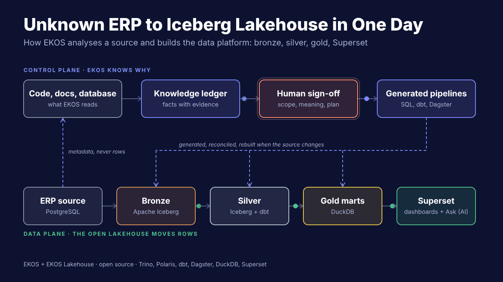
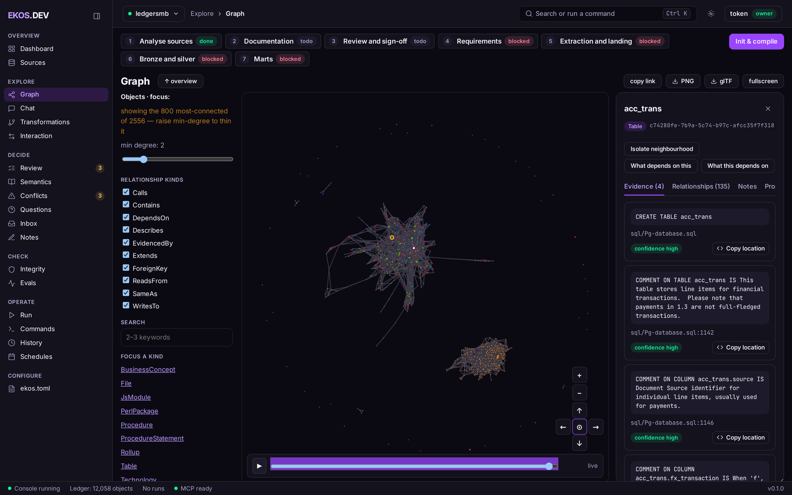
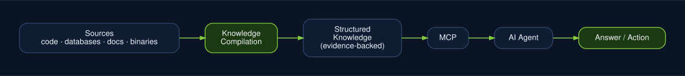

<h1 align="center">EKOS</h1>

<p align="center">
  <b>Turn your code, databases and docs into a knowledge graph your AI agent can query.</b><br>
  Every fact comes with the file and line it was read from. Runs on your machine. Open source.
</p>

<p align="center">
  <b>English</b> · <a href="README.zh-CN.md">简体中文</a> · <a href="README.ja.md">日本語</a>
</p>

<p align="center">
  <a href="https://github.com/alexeyban/EKOS/releases/latest"></a>
  <a href="LICENSE"></a>
  <a href="https://github.com/alexeyban/EKOS/actions/workflows/ci.yml"></a>
  <a href="https://sonarcloud.io/summary/new_code?id=alexeyban_EKOS"></a>
  <a href="https://github.com/alexeyban/EKOS/stargazers"></a>
  <a href="https://pypi.org/project/ekos/"></a>
</p>

<p align="center">
  <a href="#quick-start">Quick start</a> ·
  <a href="https://ekos.dev/docs/">Docs</a> ·
  <a href="https://ekos.dev/demo/">Demo videos</a> ·
  <a href="#measured-results">Benchmarks</a> ·
  <a href="docs/REFERENCE.md">Full reference</a> ·
  <a href="https://github.com/alexeyban/EKOS/discussions">Discussions</a>
</p>

<p align="center">
  <br>
  <sub>EKOS reads the code, docs and database of an unknown ERP, people sign off the scope and meaning, and EKOS Lakehouse generates the pipelines: PostgreSQL to Iceberg, dbt, DuckDB marts and Superset.</sub>
</p>

An AI agent that works on a real system spends most of its tokens rediscovering it: it greps the
code, re-reads the schema and guesses how the parts connect, again in every session. EKOS does
that work once. It reads the sources, compiles them into one graph of tables, functions, jobs,
documents and the links between them, and serves that graph to the agent over
[MCP](https://modelcontextprotocol.io/).

- **Compiled, not guessed.** Parsers and deterministic passes build the graph. No model call is
  needed to compile, so the same sources always give the same result.
- **Every fact cites its source.** An answer points to the file and line, the SQL statement or the
  commit it came from. Where two sources disagree, EKOS reports the conflict and does not pick a
  side.
- **More than code.** One graph covers application code, SQL schemas and stored procedures, live
  database catalogs, ETL jobs (dbt, Pentaho, Talend), documents and Git history.
- **Local and read-only.** A single Rust binary. Your sources stay on your machine, the agent gets
  read-only access, and secrets are redacted before anything is stored.

<p align="center">
  <a href="https://ekos.dev/semantic-layer/"></a><br>
  <sub>LedgerSMB compiled from its repository: 12,058 objects. The selected table shows the statements it was read from, with file and line.<br>More screenshots, a worked text-to-SQL example and the benchmark detail: <a href="https://ekos.dev/semantic-layer/">ekos.dev/semantic-layer</a></sub>
</p>

## Quick start

**1. Install** (Linux, macOS):

```bash
curl -fsSL https://raw.githubusercontent.com/alexeyban/EKOS/main/install.sh | sh
```

Windows:

```powershell
powershell -ExecutionPolicy Bypass -c "irm https://raw.githubusercontent.com/alexeyban/EKOS/main/install.ps1 | iex"
```

This opens a setup page in your browser. It asks for a project directory and registers EKOS with
Claude Code, Claude Desktop or VS Code for you. Native installers (`.msi`, `.pkg`, `.deb`, `.rpm`)
are on the [releases page](https://github.com/alexeyban/EKOS/releases); other ways to install are
in the [installation guide](https://ekos.dev/docs/getting-started/installation.html).

**2. Compile a repository** (the setup page does this for the first project; this is the same from
a terminal):

```bash
cd /path/to/your/repo
ekos init --detect
ekos build && ekos recover && ekos resolve && ekos compile && ekos commit
```

**3. Ask.** In your agent, or from the terminal:

```bash
ekos ask "what does this system do?"
ekos query find "payment" --mode hybrid
ekos ekl "FIND Object WHERE kind = 'Table'"
```

To connect an agent by hand:

```bash
claude mcp add ekos -- ekos mcp serve --workspace /path/to/your/repo
```

**From Python.** The same compiled graph, read in-process
([guide](https://ekos.dev/docs/usage/python.html), [examples](python/examples)):

```python
import ekos                                  # pip install ekos

kb = ekos.open("/path/to/your/repo")         # read-only, in your process, no server
hit = kb.search("orders")[0]
print(kb.get(hit.id).evidence)               # the file and line each fact was read from
print(kb.impact(hit.id, hops=3))             # what a change to it would reach
```

## What you can ask

| Question | What answers it |
|---|---|
| What breaks if I change the `orders` table? | Impact tracing across code, SQL, views, procedures and ETL jobs |
| Where is this table written, and by which job? | Data lineage through SQL, dbt, Pentaho and Talend |
| What does this stored procedure or legacy job actually do? | A step-by-step explanation, each step cited |
| Write SQL for "revenue per customer last quarter" | A SQL agent that knows the schema, joins and code values, and checks its query before answering |
| Do the docs still match the code and the data? | A list of conflicts, with each side's claim and where it was stated |
| What changed since last week? | A diff of the knowledge itself, not of text files |

## What the model holds

Before an agent writes a query or changes a table it has to know six things. A schema dump answers one of them.

| Question | In EKOS | Read from |
|---|---|---|
| What does it mean? | Concepts and code meanings, each a hypothesis until a person confirms it | Comments, constraints, seed rows, filters in views, procedures and ETL steps, glossaries |
| Where is it? | Tables and columns | DDL, migration scripts, live catalogs, ORM models |
| What is connected? | Relationships | Declared foreign keys; keys found in the data stay candidates until accepted |
| How is it calculated? | Metrics and transformations | Views, stored procedures, dbt, Pentaho, Talend, imported Apache Ossie models |
| Where does it come from? | Evidence and lineage | The file and line, statement or commit behind every object |
| Can I rely on it? | Review status, conflicts, sign-off | People's decisions; an answer built on a disputed fact is marked `disputed` |

The model exports to [Apache Ossie](https://ossie.apache.org/) and LinkML and reads Ossie models others wrote. The full tour, with screenshots: [ekos.dev/semantic-layer](https://ekos.dev/semantic-layer/).

## How it works

<p align="center">
  
</p>

1. **Observe.** Connectors read each source as it is: files, Git history, database catalogs,
   documents. Nothing is summarised or rewritten on the way in.
2. **Compile.** Deterministic passes parse the sources, match the same thing seen in two places,
   and build one model of objects, relationships and events. Each one keeps its evidence.
3. **Store.** The result goes into an append-only ledger. Nothing is edited in place, so you can
   see what was known at any earlier time.
4. **Serve.** Agents read the ledger through a read-only MCP server. People use the CLI or the web
   console.

People decide what only people should decide. Confirming a business definition, settling a
conflict or approving a migration is a CLI or console action; an agent cannot do it over MCP.

## Measured results

| Test | Result |
|---|---|
| [BIRD Mini-Dev](https://alexeyban.github.io/EKOS/presentations/bird-mini-dev-benchmark.html) text-to-SQL, 302 hold-out questions, same model (Claude Haiku 5.5) | **53.3%** on the raw schema → **76.2%** with EKOS knowledge and checks |
| [BIRD dev](https://github.com/alexeyban/ekos-text2sql-bird) text-to-SQL, all 1,534 questions, one answer per question, no fine-tuning | **66.2%** with Claude Haiku 5.5, for $3.20; **74.3%** with Claude Sonnet 5.5 on a 300-question sample |
| [Token use](https://alexeyban.github.io/EKOS/presentations/token-benchmark.html) on a 2,022-file repository ([plausible/analytics](https://github.com/plausible/analytics)), against grep-based search | **67–93% fewer tokens** per question |
| Cold compile of that repository | **34 seconds** |
| A 903-table Oracle ERP (iDempiere), analysed end to end ([video](https://youtu.be/pnGLymT6JH0)) | **0 model calls** to compile |

Each link holds the method, the commands and the raw output, including the cases where EKOS lost.

## What it reads

| Source | Coverage |
|---|---|
| Code | Rust, Python (with PySpark), JavaScript/TypeScript, Java, Elixir, Perl |
| SQL files | PostgreSQL, Oracle, MySQL, SQL Server, Snowflake, Databricks, ClickHouse, Trino, SQLite; views, triggers, PL/pgSQL and PL/SQL routines |
| Live databases | Oracle, PostgreSQL and ClickHouse catalogs, read-only |
| ETL and modelling | dbt, Pentaho Kettle, Talend |
| Documents | Markdown, PDF, DOCX, HTML, spreadsheets, slides, Confluence |
| History | Git commits, GitHub issues and pull requests |

## How it compares

| | Grep and file reads | Vector RAG | Code-graph tools | EKOS |
|---|---|---|---|---|
| Built once, reused in every session | no | yes | yes | yes |
| Same input gives the same result | yes | depends on the model | mostly | yes |
| Each fact cites file and line | by hand | chunk only | partly | yes |
| Covers databases, ETL jobs and documents in the same graph | no | text only | mostly code | yes |
| Reports where sources disagree | no | no | no | yes |

## Beyond the agent

- **Web console**: projects, a graph view, review and sign-off, chat with a project, teams and
  roles. [Deployment guide](docs/deployment.md).
- **Review workflow**: a person signs off the source model before anything is built on it.
  [Operator workflow](docs/operator-workflow.md).
- **EKOS Lakehouse**: generates a PostgreSQL or Oracle to Apache Iceberg pipeline from the compiled
  knowledge, and translates Pentaho and Talend jobs to dbt.
  [ekos-lakehouse](https://github.com/alexeyban/ekos-lakehouse).
- **EKOS Migrate**: PostgreSQL to ClickHouse, with every table validated against its source.
- **Exports**: generated documentation, dbt models, LinkML and Apache Ossie semantic models.

All of it, command by command, is in the [full reference](docs/REFERENCE.md) and at
[ekos.dev/docs](https://ekos.dev/docs/).

## Project

EKOS is built in public. Every capability starts as a written design
([RFCs](ekos/docs/rfcs/)), and the [devlogs](devlogs/) record what shipped and what was learned.
[CHANGELOG.md](CHANGELOG.md) lists each release.

- Questions and ideas: [GitHub Discussions](https://github.com/alexeyban/EKOS/discussions)
- Bugs: [GitHub Issues](https://github.com/alexeyban/EKOS/issues)
- News: [@ekosproject](https://x.com/ekosproject) on X
- Team and roadmap: [ekos.dev](https://ekos.dev)
- To build from source: `cd ekos && cargo build --workspace`. See [CLAUDE.md](CLAUDE.md) for the
  crate map and the development workflow.

If EKOS is useful to you, a star helps other people find it.

## Licence

MIT. See [LICENSE](LICENSE).
