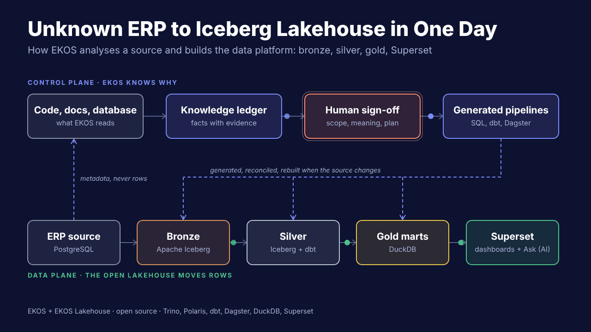
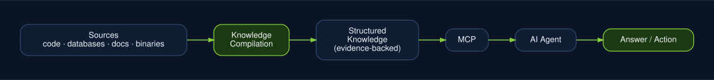

<h1 align="center">EKOS</h1>

<p align="center">
  <b>把代码、数据库和文档变成 AI 智能体可以查询的知识图谱。</b><br>
  每条事实都附带它所来自的文件和行号。在你自己的机器上运行。开源。
</p>

<p align="center">
  <a href="README.md">English</a> · <b>简体中文</b> · <a href="README.ja.md">日本語</a>
</p>

<p align="center">
  <a href="https://github.com/alexeyban/EKOS/releases/latest"></a>
  <a href="LICENSE"></a>
  <a href="https://github.com/alexeyban/EKOS/actions/workflows/ci.yml"></a>
  <a href="https://sonarcloud.io/summary/new_code?id=alexeyban_EKOS"></a>
  <a href="https://github.com/alexeyban/EKOS/stargazers"></a>
</p>

<p align="center">
  <a href="#快速开始">快速开始</a> ·
  <a href="https://ekos.dev/zh/">网站</a> ·
  <a href="https://ekos.dev/docs/">文档（英文）</a> ·
  <a href="https://ekos.dev/demo/">演示视频</a> ·
  <a href="#实测结果">基准测试</a> ·
  <a href="docs/REFERENCE.md">完整参考（英文）</a> ·
  <a href="https://github.com/alexeyban/EKOS/discussions">讨论区</a>
</p>

<p align="center">
  <br>
  <sub>EKOS 读取一个陌生 ERP 的代码、文档和数据库，由人签核范围和含义，然后 EKOS Lakehouse 生成管道：从 PostgreSQL 到 Iceberg、dbt、DuckDB 数据集市和 Superset。</sub>
</p>

> 本文是 [README.md](README.md) 的中文翻译。文档、参考手册和演示视频目前只有英文。

在真实系统上工作的 AI 智能体，把大部分 token 花在重新摸清系统上：它用 grep 搜代码、重读表结构、猜测各部分如何关联，而且每次会话都要重来一遍。EKOS 只做一次这件事。它读取各个来源，把它们编译成一张图，图里有表、函数、作业、文档以及它们之间的关联，然后通过 [MCP](https://modelcontextprotocol.io/) 把这张图提供给智能体。

- **是编译出来的，不是猜出来的。** 图由解析器和确定性的编译步骤构建。编译不需要调用任何模型，所以相同的来源总是得到相同的结果。
- **每条事实都标明出处。** 答案会指向它所依据的文件和行号、SQL 语句或提交记录。当两个来源说法不一致时，EKOS 会报告这个冲突，而不是替你选边。
- **不只是代码。** 同一张图涵盖应用代码、SQL 表结构和存储过程、在线数据库目录、ETL 作业（dbt、Pentaho、Talend）、文档和 Git 历史。
- **本地运行，只读访问。** 只有一个 Rust 二进制文件。你的源码留在你的机器上，智能体只有只读权限，密钥在存储之前就会被脱敏。

## 快速开始

**1. 安装**（Linux、macOS）：

```bash
curl -fsSL https://raw.githubusercontent.com/alexeyban/EKOS/main/install.sh | sh
```

Windows：

```powershell
powershell -ExecutionPolicy Bypass -c "irm https://raw.githubusercontent.com/alexeyban/EKOS/main/install.ps1 | iex"
```

安装后会在浏览器中打开一个设置页面（页面为英文）。它会询问项目目录，并替你把 EKOS 注册到 Claude Code、Claude Desktop 或 VS Code。原生安装包（`.msi`、`.pkg`、`.deb`、`.rpm`）在[发布页面](https://github.com/alexeyban/EKOS/releases)；其他安装方式见[安装指南](https://ekos.dev/docs/getting-started/installation.html)。

**2. 编译一个仓库**（设置页面会为第一个项目完成这一步；下面是在终端里做同样的事）：

```bash
cd /path/to/your/repo
ekos init --detect
ekos build && ekos recover && ekos resolve && ekos compile && ekos commit
```

**3. 提问。** 在你的智能体里，或者在终端里：

```bash
ekos ask "what does this system do?"
ekos query find "payment" --mode hybrid
ekos ekl "FIND Object WHERE kind = 'Table'"
```

手动连接智能体：

```bash
claude mcp add ekos -- ekos mcp serve --workspace /path/to/your/repo
```

## 你可以问什么

| 问题 | 由什么来回答 |
|---|---|
| 如果我修改 `orders` 表，哪些地方会出问题？ | 跨代码、SQL、视图、存储过程和 ETL 作业的影响分析 |
| 这张表在哪里被写入，由哪个作业写入？ | 贯穿 SQL、dbt、Pentaho 和 Talend 的数据血缘 |
| 这个存储过程或遗留作业到底做了什么？ | 逐步的解释，每一步都标明出处 |
| 为“上个季度每个客户的收入”写一条 SQL | 一个了解表结构、关联关系和代码值的 SQL 智能体，在回答之前先检查自己的查询 |
| 文档和代码、数据还一致吗？ | 一份冲突清单，列出每一方的说法及其出处 |
| 上周以来发生了什么变化？ | 知识本身的差异，而不是文本文件的差异 |

## 工作原理

<p align="center">
  
</p>

1. **观察。** 连接器按原样读取每个来源：文件、Git 历史、数据库目录、文档。读入过程中不做任何摘要或改写。
2. **编译。** 确定性的编译步骤解析这些来源，把在两处出现的同一事物对应起来，并建立一个由对象、关系和事件组成的模型。每一项都保留自己的证据。
3. **存储。** 结果写入只追加的账本。不会原地修改任何内容，所以你可以看到任意历史时刻已知的信息。
4. **提供。** 智能体通过只读的 MCP 服务器读取账本。人则使用 CLI 或 Web 控制台。

只应该由人决定的事情，由人来决定。确认业务定义、裁定冲突或批准迁移，都是 CLI 或控制台中的操作；智能体无法通过 MCP 完成这些操作。

## 实测结果

| 测试 | 结果 |
|---|---|
| [BIRD Mini-Dev](https://alexeyban.github.io/EKOS/presentations/bird-mini-dev-benchmark.html) text-to-SQL，302 道保留题，同一模型（Claude Haiku 5.5） | 只给原始表结构 **53.3%** → 使用 EKOS 的知识与检查 **76.2%** |
| [BIRD dev](https://github.com/alexeyban/ekos-text2sql-bird) text-to-SQL，全部 1,534 道题，每题只生成一个答案，不做微调 | 使用 Claude Haiku 5.5 **66.2%**，花费 $3.20；使用 Claude Sonnet 5.5 在 300 道题的抽样上 **74.3%** |
| 在一个 2,022 个文件的仓库（[plausible/analytics](https://github.com/plausible/analytics)）上的 [token 用量](https://alexeyban.github.io/EKOS/presentations/token-benchmark.html)，与基于 grep 的搜索相比 | 每个问题**少用 67–93% 的 token** |
| 首次完整编译该仓库 | **34 秒** |
| 一个 903 张表的 Oracle ERP（iDempiere），端到端分析（[视频](https://youtu.be/pnGLymT6JH0)） | 编译过程 **0 次模型调用** |

每个链接都给出方法、命令和原始输出，包括 EKOS 输掉的情况。

## 它能读取什么

| 来源 | 覆盖范围 |
|---|---|
| 代码 | Rust、Python（含 PySpark）、JavaScript/TypeScript、Java、Elixir、Perl |
| SQL 文件 | PostgreSQL、Oracle、MySQL、SQL Server、Snowflake、Databricks、ClickHouse、Trino、SQLite；视图、触发器、PL/pgSQL 和 PL/SQL 例程 |
| 在线数据库 | Oracle、PostgreSQL 和 ClickHouse 的目录，只读 |
| ETL 与建模 | dbt、Pentaho Kettle、Talend |
| 文档 | Markdown、PDF、DOCX、HTML、电子表格、幻灯片、Confluence |
| 历史 | Git 提交、GitHub issue 和 pull request |

## 对比

| | grep 和读文件 | 向量 RAG | 代码图工具 | EKOS |
|---|---|---|---|---|
| 构建一次，每次会话复用 | 否 | 是 | 是 | 是 |
| 相同输入得到相同结果 | 是 | 取决于模型 | 基本是 | 是 |
| 每条事实标明文件和行号 | 需手工 | 只到文本块 | 部分 | 是 |
| 数据库、ETL 作业和文档在同一张图中 | 否 | 仅文本 | 主要是代码 | 是 |
| 报告来源之间的不一致 | 否 | 否 | 否 | 是 |

## 不止于智能体

- **Web 控制台**：项目、图视图、审核与签字确认、与项目对话、团队和角色。[部署指南](docs/deployment.md)（英文）。
- **审核工作流**：在其上构建任何东西之前，先由人对源模型签字确认。[操作流程](docs/operator-workflow.md)（英文）。
- **EKOS Lakehouse**：根据编译出的知识生成从 PostgreSQL 或 Oracle 到 Apache Iceberg 的数据管道，并把 Pentaho 和 Talend 作业翻译成 dbt。[ekos-lakehouse](https://github.com/alexeyban/ekos-lakehouse)。
- **EKOS Migrate**：从 PostgreSQL 迁移到 ClickHouse，每张表都与源表校验。
- **导出**：生成的文档、dbt 模型、LinkML 和 Apache Ossie 语义模型。

所有功能的逐条命令说明见[完整参考](docs/REFERENCE.md)和 [ekos.dev/docs](https://ekos.dev/docs/)（均为英文）。

## 项目

EKOS 以公开方式开发。每项功能都从一份书面设计（[RFC](ekos/docs/rfcs/)）开始，[开发日志](devlogs/)记录发布了什么、学到了什么。[CHANGELOG.md](CHANGELOG.md) 列出每个版本。

- 问题和想法：[GitHub Discussions](https://github.com/alexeyban/EKOS/discussions)
- 缺陷：[GitHub Issues](https://github.com/alexeyban/EKOS/issues)
- 动态：X 上的 [@ekosproject](https://x.com/ekosproject)
- 团队和路线图：[ekos.dev/zh](https://ekos.dev/zh/)
- 从源码构建：`cd ekos && cargo build --workspace`。crate 结构和开发流程见 [CLAUDE.md](CLAUDE.md)。

如果 EKOS 对你有用，点一个 star 能帮助更多人发现它。

## 许可证

MIT。见 [LICENSE](LICENSE)。
